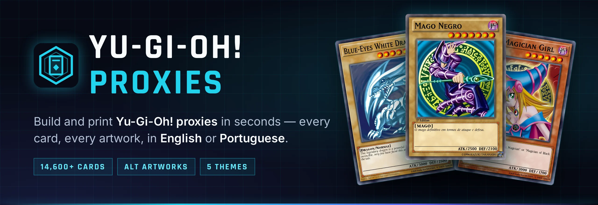
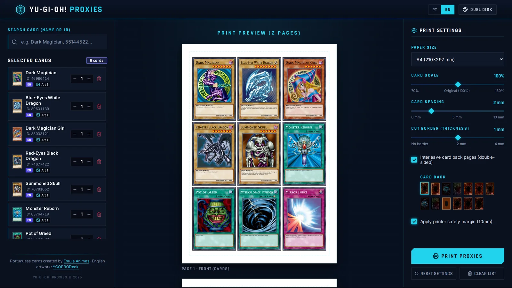
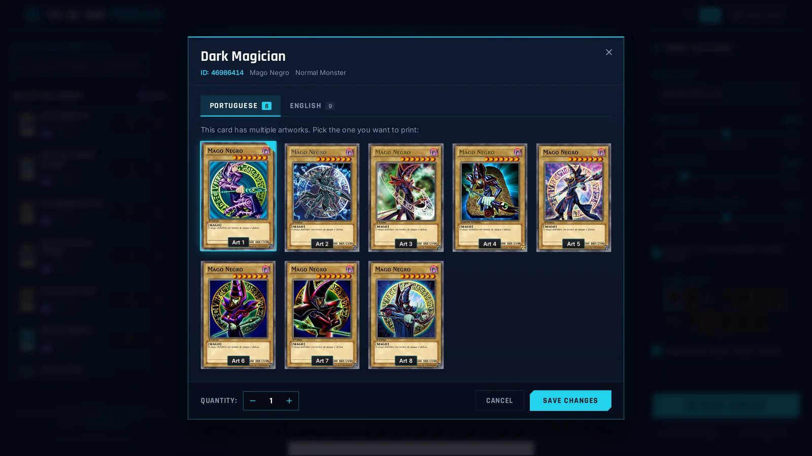
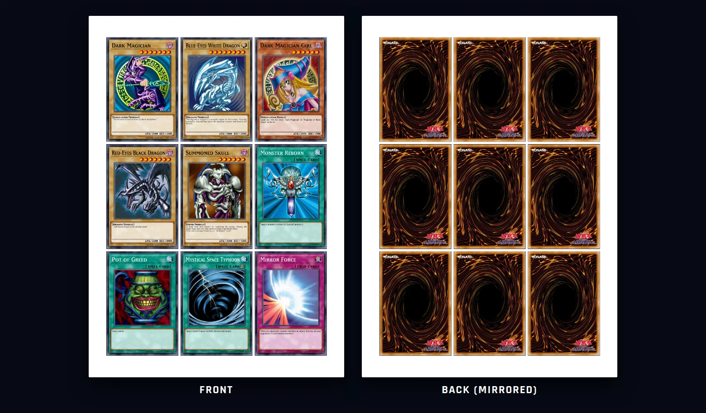
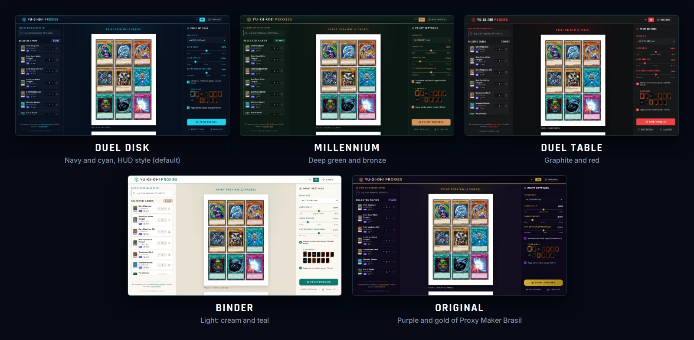

<p align="center">
  
</p>

<p align="center">
  <a href="https://yugioh-proxy.pages.dev"></a>
</p>

<p align="center">
  <b>English</b> · <a href="README.pt-BR.md">Português (Brasil)</a>
</p>

<p align="center">
  <a href="https://yugioh-proxy.pages.dev"></a>
  <a href="https://lucasfrag.github.io/yugioh-proxy/"></a>
  
  
  
  
  
</p>

<p align="center">
  <a href="#-features">Features</a> ·
  <a href="#-quick-start">Quick start</a> ·
  <a href="#-portuguese-cards">Portuguese cards</a> ·
  <a href="#-themes">Themes</a> ·
  <a href="#-how-it-works">How it works</a> ·
  <a href="#-credits">Credits</a>
</p>

**Yu-Gi-Oh! Proxies** is a web app to build and print Yu-Gi-Oh! proxy cards for casual play and deck testing. Search any of the 14,600+ cards, pick the exact artwork you want — in English or in Portuguese — and print sheets at the official card size, ready to cut.

**👉 Use it online, free and with no sign-up: [yugioh-proxy.pages.dev](https://yugioh-proxy.pages.dev)**

<p align="center">
  
</p>

## ✨ Features

- **Every card** — fuzzy search across 14,600+ cards by English name, Portuguese name or card ID. Typos are fine.
- **Every artwork** — all alternate artworks, as clean digital renders at 813 × 1185 px (~350 dpi at real size).
- **English or Portuguese** — the interface, card names and card types switch between English and Brazilian Portuguese, and 1,900+ cards are available as HD Portuguese prints.
- **Print-accurate sheets** — official 59 × 86 mm size (scalable 70–130%), A2 to A5, Letter, Legal and Tabloid, card spacing, cut borders and a printer safety margin. The preview is exactly what gets printed.
- **Double-sided printing** — optional mirrored back pages, with up to 13 card back designs.
- **Five themes** — Duel Disk, Millennium, Duel Table, Binder and the Original look. Your choice is remembered.
- **Runs locally, no account** — your list and settings are saved in your browser.

<table>
  <tr>
    <td width="50%"></td>
    <td width="50%"></td>
  </tr>
  <tr>
    <td align="center"><b>Pick the artwork and the language</b></td>
    <td align="center"><b>Real size, front and back</b></td>
  </tr>
</table>

## 🚀 Quick start

**Online:** just open **[yugioh-proxy.pages.dev](https://yugioh-proxy.pages.dev)** — nothing to install.

**On your machine:** you need **Node.js 20.9 or newer**. The project ships an `.nvmrc`, so if you use [nvm](https://github.com/nvm-sh/nvm) the script picks the right version by itself.

```bash
git clone https://github.com/lucasfrag/yugioh-proxy.git
cd yugioh-proxy
./run.sh
```

Then open **http://localhost:3000**. On the first run, `run.sh` installs the dependencies, downloads the card database from YGOPRODeck, builds the site and starts it.

| Command | What it does |
|---|---|
| `./run.sh` | Install what is missing, build the site and start it at `http://localhost:3000` |
| `./run.sh cartas-pt` | Download the Portuguese HD cards (optional, see below) and start the site |
| `./run.sh atualizar` | Download the card database again, to pick up newly released cards |
| `./run.sh dev` | Development mode with hot reload (usually `http://localhost:5173`) |

Use another port with `PORT=8080 ./run.sh`.

> [!NOTE]
> The [online version](https://yugioh-proxy.pages.dev) is a static build hosted for free on Cloudflare Pages: search runs in your browser and card images are hosted copies, never hotlinked (as YGOPRODeck asks). For now it has **English artwork only**; the Portuguese cards are available when you run the app locally (`./run.sh cartas-pt`).

## 🇧🇷 Portuguese cards

The Portuguese cards are a fan-made collection of **2,300+ cards recreated in HD by [Emula Animes](https://www.youtube.com/watch?v=JqDxDtMwyME)**, shared for free on the blog **[Cartas Caseiras](https://cartascaseiras.blogspot.com/2021/04/cartas-de-yu-gi-oh-pt-br-para-imprimir.html)**. They are the same cards used by the original Proxy Maker Brasil.

- `./run.sh` asks once whether you want them; you can also run `./run.sh cartas-pt` at any time.
- They are downloaded **straight from the creator's public folder** and converted from PNG to WebP (~200 KB per card, ~450 MB in total). The download can be interrupted and resumed.
- **This project does not host any of these images.** They live in `api/imagens/` (ignored by git), together with a `CREDITOS.txt` file crediting the creator.
- About 1,925 cards end up with Portuguese artwork; every other card uses the English artwork.
- Found a mistake in a card? Tell the creator in the blog comments.

## 🎨 Themes

Switch themes from the palette button in the top bar. Printing is never affected: sheets are always plain white paper.

<p align="center">
  
</p>

| Theme | Look |
|---|---|
| **Duel Disk** (default) | Navy and cyan, square corners and HUD lines, Rajdhani headings |
| **Millennium** | Deep green and bronze, rounded corners, Cinzel headings |
| **Duel Table** | Graphite and red, understated, Oswald headings |
| **Binder** | Light theme: cream, white panels and teal, Nunito headings |
| **Original** | The purple and gold look of Proxy Maker Brasil |

Each theme only redefines CSS variables (`:root[data-theme="…"]` in `web/src/index.css`). To add a theme, copy one of those blocks, change the colors, and add an entry to `web/src/utils/themes.js` and to the translations in `web/src/utils/i18n.js`.

## 🛠️ How it works

```
yugioh-proxy/
├── api/                 Express API: card database, search, images
│   ├── scripts/         setup_database.js (card base) · baixar_cartas_pt.js (Portuguese cards)
│   ├── src/             routes, image cache, API docs page (/api)
│   ├── imagens/verso/   card backs
│   └── data/            card database and image cache (generated, not versioned)
├── web/                 React + Vite front end
│   └── src/             components, themes (index.css), translations (utils/i18n.js)
├── docs/                project website (GitHub Pages) and README images
└── run.sh               one command to install, build and run
```

- **Card data** comes from the [YGOPRODeck API](https://ygoprodeck.com/api-guide/): every card in English, plus the official Portuguese names and texts where they exist.
- **Images** are downloaded once and served from a local cache (`api/data/cache/`), never hotlinked.
- **The front end** is built into `web/dist` and served by the API itself, so everything runs on a single port.

<details>
<summary><b>API endpoints</b></summary>

| Endpoint | Description |
|---|---|
| `GET /api/cartas?nome=…` | Search by name (Portuguese or English) or ID, with pagination |
| `GET /api/cartas/:id` | One card by ID |
| `GET /api/cartas/nome/:nome` | Card by exact name |
| `GET /api/cartas/:id/imagens` | All images of a card, grouped by language (`pt`, `en`, `ocg`) |
| `GET /api/cartas/backs` | Available card backs |
| `GET /api` | Interactive API documentation page |

</details>

<details>
<summary><b>Publishing the static version</b></summary>

The online version has no server: search runs in the browser and every image is a file of the site.

```bash
npm run site-estatico   # builds site-estatico/: card index, English artwork as WebP, card backs and the site
npm run publicar        # uploads it to Cloudflare Pages (needs `npx wrangler login` once)
```

The first build downloads each English artwork from YGOPRODeck **once** (≈14,800 images, ~1.8 GB, at most 10 requests per second) and can be interrupted and resumed. Later builds and uploads only send what changed. The result stays under the 20,000-file limit of the Cloudflare Pages free plan. `npm run site-estatico -- --com-pt` also includes the Portuguese cards — only publish them with the creator's permission.

**Monthly updates.** The [`Update cards`](.github/workflows/atualizar-site.yml) GitHub Actions workflow runs on the 1st of every month (and on demand from the Actions tab): it downloads the latest card database, rebuilds the site and publishes it. Artwork that is already online is copied from the live site itself, so only newly released cards are downloaded from YGOPRODeck. It needs two repository secrets: `CLOUDFLARE_API_TOKEN` (a token with *Cloudflare Pages: Edit* permission) and `CLOUDFLARE_ACCOUNT_ID`.

</details>

<details>
<summary><b>Differences from the original Proxy Maker Brasil</b></summary>

This project builds on the code of [Proxy Maker Brasil](https://www.proxymakerbrasil.com/) by Ruan Cardoso ([yugioh-api](https://github.com/ruancard/yugioh-api) and [yugioh-proxies](https://github.com/ruancard/yugioh-proxies)), which became `api/` and `web/`.

- **All cards.** The original database only had the ~1,900 cards present in the author's private image folder. The setup now includes all ~14,600 cards from YGOPRODeck, using Portuguese names where a translation exists.
- **Artwork and language in one place.** The artwork picker groups images by language and also edits cards already in the list.
- **English interface.** Full English and Portuguese UI, including card names and types.
- **Portuguese cards from the source.** Downloaded from the creator's public folder, with credit, instead of coming from a private folder.
- **Own visual identity and themes**, plus a layout that adapts the preview to the available space.
- **More card backs:** the original six, the official TCG/OCG/Korean backs and the creator's backs.

</details>

## 🙏 Credits

- **[Emula Animes](https://www.youtube.com/watch?v=JqDxDtMwyME)** — created the Portuguese HD cards and shares them for free at [Cartas Caseiras](https://cartascaseiras.blogspot.com/2021/04/cartas-de-yu-gi-oh-pt-br-para-imprimir.html).
- **[Ruan Cardoso](https://github.com/Ruancard)** — author of [Proxy Maker Brasil](https://www.proxymakerbrasil.com/), which this project builds upon.
- **[YGOPRODeck](https://ygoprodeck.com/api-guide/)** — card data and English artwork.
- **[Yugipedia](https://yugipedia.com)** — official TCG, OCG and Korean card back images.

## ⚖️ Disclaimer

Yu-Gi-Oh! is a trademark of Konami. This is an unofficial fan project, not affiliated with or endorsed by Konami. Card images and texts are © Konami / Kazuki Takahashi. Proxies are meant for personal and casual play only: they are not allowed in sanctioned tournaments and must not be sold.
