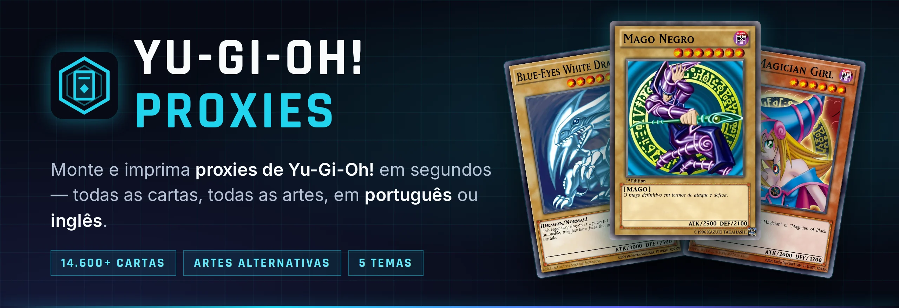
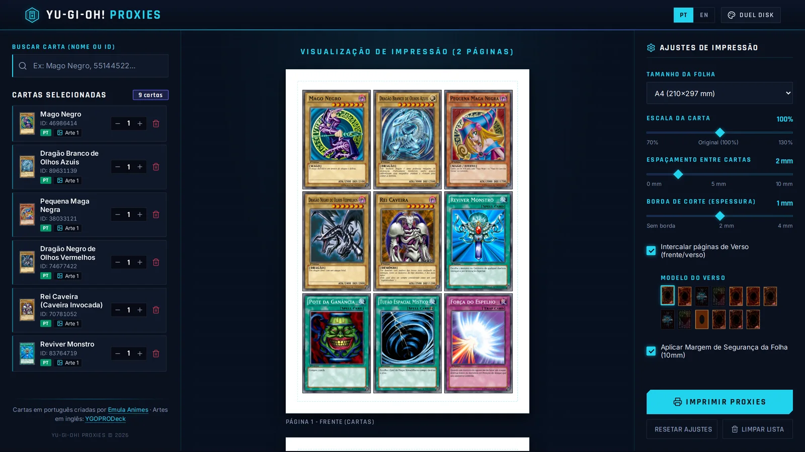
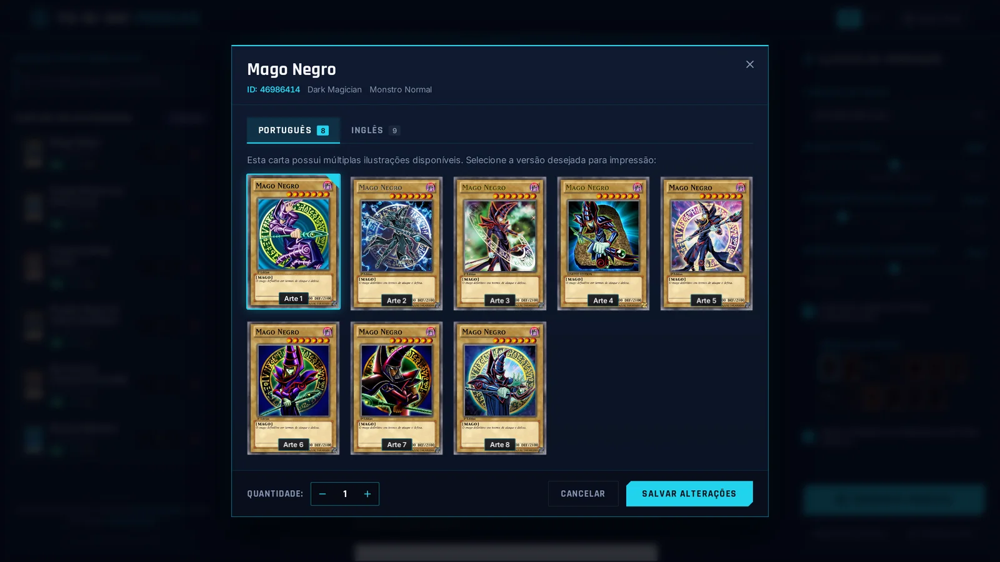
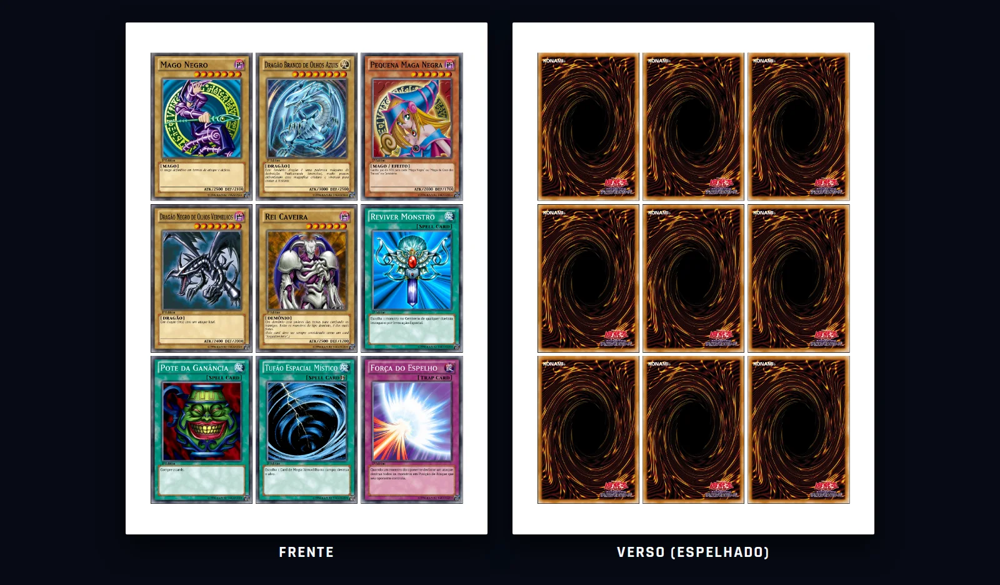
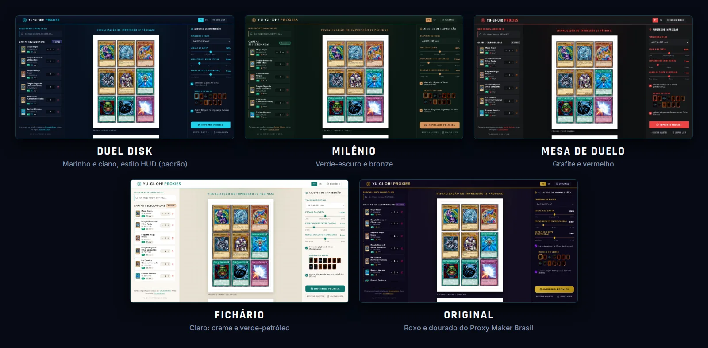

<p align="center">
  
</p>

<p align="center">
  <a href="https://yugioh-proxy.pages.dev"></a>
</p>

<p align="center">
  <a href="README.md">English</a> · <b>Português (Brasil)</b>
</p>

<p align="center">
  <a href="https://yugioh-proxy.pages.dev"></a>
  <a href="https://lucasfrag.github.io/yugioh-proxy/"></a>
  
  
  
  
  
</p>

<p align="center">
  <a href="#-recursos">Recursos</a> ·
  <a href="#-como-rodar">Como rodar</a> ·
  <a href="#-cartas-em-português">Cartas em português</a> ·
  <a href="#-temas">Temas</a> ·
  <a href="#-como-funciona">Como funciona</a> ·
  <a href="#-créditos">Créditos</a>
</p>

**Yu-Gi-Oh! Proxies** é um app web para montar e imprimir proxies de Yu-Gi-Oh! para partidas casuais e teste de decks. Busque qualquer uma das 14.600+ cartas, escolha exatamente a arte que você quer — em português ou em inglês — e imprima folhas no tamanho oficial da carta, prontas para recortar.

**👉 Use online, de graça e sem cadastro: [yugioh-proxy.pages.dev](https://yugioh-proxy.pages.dev)**

<p align="center">
  
</p>

## ✨ Recursos

- **Todas as cartas** — busca tolerante a erros em 14.600+ cartas, pelo nome em português, em inglês ou pelo ID.
- **Todas as artes** — todas as artes alternativas, em renderizações digitais de 813 × 1185 px (~350 dpi no tamanho real).
- **Português ou inglês** — a interface, os nomes e os tipos das cartas mudam entre português e inglês, e 1.900+ cartas estão disponíveis em português em HD.
- **Folhas no tamanho exato** — tamanho oficial de 59 × 86 mm (escala de 70% a 130%), folhas de A2 a A5, Carta, Ofício e Tabloide, espaçamento, borda de corte e margem de segurança da impressora. A prévia é exatamente o que sai impresso.
- **Frente e verso** — páginas de verso espelhadas opcionais, com até 13 modelos de verso.
- **Cinco temas** — Duel Disk, Milênio, Mesa de Duelo, Fichário e o visual Original. O site lembra a sua escolha.
- **Roda localmente, sem conta** — sua lista e seus ajustes ficam salvos no navegador.

<table>
  <tr>
    <td width="50%"></td>
    <td width="50%"></td>
  </tr>
  <tr>
    <td align="center"><b>Escolha a arte e o idioma</b></td>
    <td align="center"><b>Tamanho real, frente e verso</b></td>
  </tr>
</table>

## 🚀 Como rodar

**Online:** é só abrir **[yugioh-proxy.pages.dev](https://yugioh-proxy.pages.dev)** — não precisa instalar nada.

**Na sua máquina:** você precisa do **Node.js 20.9 ou mais novo**. O projeto traz um `.nvmrc`; se você usa o [nvm](https://github.com/nvm-sh/nvm), o script ativa a versão certa sozinho.

```bash
git clone https://github.com/lucasfrag/yugioh-proxy.git
cd yugioh-proxy
./run.sh
```

Depois abra **http://localhost:3000**. Na primeira vez, o `run.sh` instala as dependências, baixa a base de cartas do YGOPRODeck, gera o site e sobe tudo.

| Comando | O que faz |
|---|---|
| `./run.sh` | Instala o que faltar, gera o site e sobe em `http://localhost:3000` |
| `./run.sh cartas-pt` | Baixa as cartas em português em HD (opcional, veja abaixo) e sobe o site |
| `./run.sh atualizar` | Baixa a base de cartas de novo, para pegar cartas lançadas recentemente |
| `./run.sh dev` | Modo desenvolvimento, recarrega ao editar (normalmente em `http://localhost:5173`) |

Para usar outra porta: `PORT=8080 ./run.sh`.

> [!NOTE]
> A [versão online](https://yugioh-proxy.pages.dev) é um build estático hospedado de graça no Cloudflare Pages: a busca roda no seu navegador e as imagens das cartas são cópias hospedadas, nunca puxadas direto de outro site (como o YGOPRODeck pede). Por enquanto ela tem **só as artes em inglês**; as cartas em português ficam disponíveis rodando o app localmente (`./run.sh cartas-pt`).

## 🇧🇷 Cartas em português

As cartas em português são uma coleção feita por fãs: **2.300+ cartas recriadas em HD pelo [Emula Animes](https://www.youtube.com/watch?v=JqDxDtMwyME)**, distribuídas de graça no blog **[Cartas Caseiras](https://cartascaseiras.blogspot.com/2021/04/cartas-de-yu-gi-oh-pt-br-para-imprimir.html)**. São as mesmas cartas usadas pelo Proxy Maker Brasil original.

- O `./run.sh` pergunta uma vez se você quer baixá-las; também dá para rodar `./run.sh cartas-pt` a qualquer momento.
- Elas são baixadas **direto da pasta pública do criador** e convertidas de PNG para WebP (~200 KB por carta, ~450 MB no total). O download pode ser interrompido e retomado.
- **Este projeto não hospeda nenhuma dessas imagens.** Elas ficam em `api/imagens/` (fora do git), junto com um `CREDITOS.txt` que credita o criador.
- Cerca de 1.925 cartas ficam com arte em português; as demais usam a arte em inglês.
- Encontrou um erro numa carta? Avise o criador nos comentários do blog.

## 🎨 Temas

Troque de tema pelo botão de paleta na barra do topo. A impressão nunca muda: as folhas saem sempre em papel branco.

<p align="center">
  
</p>

| Tema | Visual |
|---|---|
| **Duel Disk** (padrão) | Marinho e ciano, cantos retos e linhas de HUD, títulos em Rajdhani |
| **Milênio** | Verde-escuro e bronze, cantos arredondados, títulos em Cinzel |
| **Mesa de Duelo** | Grafite e vermelho, sóbrio, títulos em Oswald |
| **Fichário** | Tema claro: creme, painéis brancos e verde-petróleo, títulos em Nunito |
| **Original** | O visual roxo e dourado do Proxy Maker Brasil |

Cada tema só redefine variáveis CSS (`:root[data-theme="…"]` em `web/src/index.css`). Para criar um tema, copie um desses blocos, ajuste as cores e acrescente o tema em `web/src/utils/themes.js` e nas traduções de `web/src/utils/i18n.js`.

## 🛠️ Como funciona

```
yugioh-proxy/
├── api/                 API Express: base de cartas, busca, imagens
│   ├── scripts/         setup_database.js (base de cartas) · baixar_cartas_pt.js (cartas em português)
│   ├── src/             rotas, cache de imagens, página de documentação da API (/api)
│   ├── imagens/verso/   versos das cartas
│   └── data/            base de cartas e cache de imagens (gerados, fora do git)
├── web/                 front-end em React + Vite
│   └── src/             componentes, temas (index.css), traduções (utils/i18n.js)
├── docs/                site do projeto (GitHub Pages) e imagens do README
└── run.sh               um comando para instalar, gerar e rodar
```

- **Os dados das cartas** vêm da [API do YGOPRODeck](https://ygoprodeck.com/api-guide/): todas as cartas em inglês, mais os nomes e textos oficiais em português quando existem.
- **As imagens** são baixadas uma vez e servidas de um cache local (`api/data/cache/`), nunca puxadas direto de outro site.
- **O front-end** é gerado em `web/dist` e servido pela própria API, então tudo roda numa porta só.

<details>
<summary><b>Rotas da API</b></summary>

| Rota | Descrição |
|---|---|
| `GET /api/cartas?nome=…` | Busca por nome (português ou inglês) ou ID, com paginação |
| `GET /api/cartas/:id` | Uma carta pelo ID |
| `GET /api/cartas/nome/:nome` | Carta pelo nome exato |
| `GET /api/cartas/:id/imagens` | Todas as imagens de uma carta, por idioma (`pt`, `en`, `ocg`) |
| `GET /api/cartas/backs` | Versos disponíveis |
| `GET /api` | Página interativa de documentação da API |

</details>

<details>
<summary><b>Publicando a versão estática</b></summary>

A versão online não tem servidor: a busca roda no navegador e todas as imagens são arquivos do site.

```bash
npm run site-estatico   # gera site-estatico/: índice das cartas, artes em inglês em WebP, versos e o site
npm run publicar        # envia para o Cloudflare Pages (precisa de `npx wrangler login` uma vez)
```

A primeira geração baixa cada arte em inglês do YGOPRODeck **uma única vez** (≈14.800 imagens, ~1,8 GB, no máximo 10 pedidos por segundo) e pode ser interrompida e retomada. As próximas gerações e publicações enviam só o que mudou. O resultado fica abaixo do limite de 20.000 arquivos do plano grátis do Cloudflare Pages. `npm run site-estatico -- --com-pt` inclui também as cartas em português — publique-as só com autorização do criador.

**Atualização mensal.** O workflow [`Update cards`](.github/workflows/atualizar-site.yml) do GitHub Actions roda no dia 1º de cada mês (e quando você quiser, pela aba Actions): baixa a base de cartas mais recente, gera o site de novo e publica. As artes que já estão online são copiadas do próprio site publicado, então só as cartas recém-lançadas são baixadas do YGOPRODeck. Ele precisa de dois segredos no repositório: `CLOUDFLARE_API_TOKEN` (um token com permissão *Cloudflare Pages: Edit*) e `CLOUDFLARE_ACCOUNT_ID`.

</details>

<details>
<summary><b>Diferenças em relação ao Proxy Maker Brasil original</b></summary>

Este projeto parte do código do [Proxy Maker Brasil](https://www.proxymakerbrasil.com/), de Ruan Cardoso ([yugioh-api](https://github.com/ruancard/yugioh-api) e [yugioh-proxies](https://github.com/ruancard/yugioh-proxies)), que viraram `api/` e `web/`.

- **Todas as cartas.** A base original só tinha as ~1.900 cartas que estavam na pasta particular de imagens do autor. Agora o setup inclui as ~14.600 cartas do YGOPRODeck, com o nome em português quando existe tradução.
- **Arte e idioma no mesmo lugar.** O seletor de artes agrupa as imagens por idioma e também edita as cartas que já estão na lista.
- **Interface em inglês.** Interface completa em português e inglês, incluindo nomes e tipos das cartas.
- **Cartas em português direto da fonte.** Baixadas da pasta pública do criador, com crédito, em vez de uma pasta particular.
- **Identidade visual e temas próprios**, e um layout que ajusta a prévia ao espaço disponível.
- **Mais versos:** os seis originais, os oficiais TCG/OCG/coreano e os do criador das cartas em português.

</details>

## 🙏 Créditos

- **[Emula Animes](https://www.youtube.com/watch?v=JqDxDtMwyME)** — criou as cartas em português em HD e as distribui de graça no blog [Cartas Caseiras](https://cartascaseiras.blogspot.com/2021/04/cartas-de-yu-gi-oh-pt-br-para-imprimir.html).
- **[Ruan Cardoso](https://github.com/Ruancard)** — autor do [Proxy Maker Brasil](https://www.proxymakerbrasil.com/), base deste projeto.
- **[YGOPRODeck](https://ygoprodeck.com/api-guide/)** — dados das cartas e artes em inglês.
- **[Yugipedia](https://yugipedia.com)** — imagens dos versos oficiais TCG, OCG e coreano.

## ⚖️ Aviso

Yu-Gi-Oh! é marca registrada da Konami. Este é um projeto de fã, não oficial e sem vínculo ou aprovação da Konami. As imagens e os textos das cartas são © Konami / Kazuki Takahashi. Proxies são para uso pessoal e casual: não são permitidas em torneios oficiais e não devem ser vendidas.
